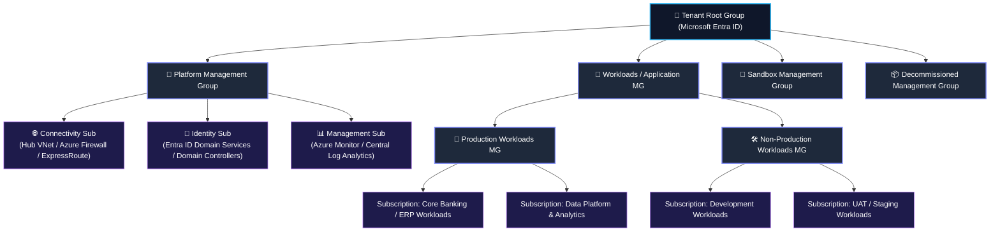
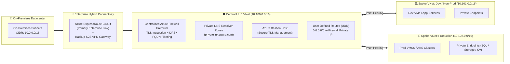
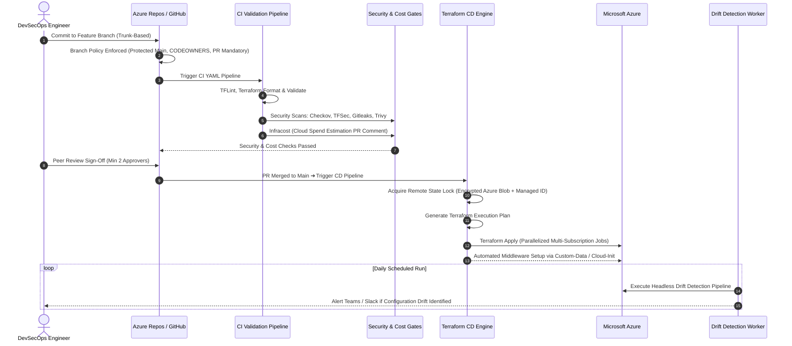

<!-- =========================================================================
     ADNAN AHMAD | SENIOR DEVSECOPS ENGINEER & CLOUD SOLUTIONS ARCHITECT
     ENTERPRISE GITHUB PROFILE README.MD
========================================================================= -->

<div align="center">

<!-- Animated Header Wave Banner -->


<!-- Dynamic Animated Typing SVG -->
<a href="https://github.com/aahmad39">
  
</a>

<p align="center">
  <b>Enterprise Cloud Architecture • Infrastructure as Code (Terraform) • DevSecOps CI/CD • FinOps • Large-Scale Migrations</b>
</p>

<!-- Key Architectural Impact Metrics -->
<p align="center">
  
  
  
  
</p>

<!-- Quick Navigation Bar -->
<table align="center" border="0">
  <tr>
    <td><a href="#-1-enterprise-architectural-pillars"><b>🏛️ Architecture</b></a></td>
    <td><a href="#-2-tenant--management-group-hierarchy-caf"><b>🏢 Landing Zone</b></a></td>
    <td><a href="#-3-hub-and-spoke-networking--hybrid-connectivity"><b>🌐 Networking</b></a></td>
    <td><a href="#-4-multi-layer-defense-in-depth-security"><b>🛡️ Security</b></a></td>
    <td><a href="#-5-terraform-landing-zone-automation--devsecops-pipelines"><b>⚙️ IaC & DevSecOps</b></a></td>
    <td><a href="#-6-100-enterprise-applications-migration-framework"><b>🚀 100+ Migration</b></a></td>
    <td><a href="#-7-finops-cloud-economics--bcdr"><b>💰 FinOps & DR</b></a></td>
    <td><a href="#-8-vendor-management-delivery-governance--leadership"><b>🤝 Leadership</b></a></td>
  </tr>
</table>

<!-- Contact & Social Badges -->
<p align="center">
  <a href="mailto:adnanhuntp@gmail.com">
    
  </a>
  <a href="https://www.linkedin.com/in/">
    
  </a>
  <a href="https://github.com/aahmad39">
    
  </a>
  
</p>

</div>

---

### 💼 Executive Profile

Accomplished **Senior DevSecOps Engineer & Enterprise Cloud Solutions Architect** with extensive experience architecting, securing, and operating mission-critical enterprise environments on **Microsoft Azure**. 

Recognized for leading end-to-end **large-scale migrations of 100+ applications** across Dev, UAT, and Production environments from legacy on-premises datacenters and multi-subscription cloud infrastructures. Expert in designing **Enterprise Azure Landing Zones (ALZ)** based on the Microsoft Cloud Adoption Framework (CAF), implementing shift-left DevSecOps automation via Terraform and Azure DevOps, driving rigorous FinOps cost optimization, ensuring high availability with disaster recovery (BCDR), and leading cross-functional engineering teams, pre-sales initiatives, and vendor delivery.

```
┌──────────────────────────────────────────────────────────────────────────────────────────────────────────────────┐
│  CORE ARCHITECTURE PRINCIPLES:                                                                                   │
│  ✔ Scalable   ✔ Robust   ✔ Secure   ✔ Reliable   ✔ Portable   ✔ Governed   ✔ High-Avail   ✔ Cost-Optimized       │
│  ✔ Automated  ✔ Backed Up   ✔ End-to-End Monitored   ✔ Audit & Regulatory Compliant (CIS / ISO / SOC2)          │
└──────────────────────────────────────────────────────────────────────────────────────────────────────────────────┘
```

---

### 🏛️ 1. Enterprise Architectural Pillars

<table width="100%">
  <tr>
    <td width="50%" valign="top" bgcolor="#0f172a">
      <div align="center">
        <h3>🏗️ Infra Design & Implementation</h3>
      </div>
      <ul>
        <li><b>Cloud Architecture & Landing Zones:</b> Multi-subscription Azure Landing Zones aligned with Microsoft CAF.</li>
        <li><b>DevSecOps & Infrastructure as Code:</b> Terraform Enterprise, reusable modules, automated drift detection.</li>
        <li><b>Hybrid Hub-and-Spoke Networking:</b> Azure ExpressRoute, S2S VPN, Central Firewall, Private Endpoints.</li>
        <li><b>Enterprise Resiliency & BCDR:</b> Multi-region Disaster Recovery, VMSS across Availability Zones, strict RTO/RPO.</li>
      </ul>
    </td>
    <td width="50%" valign="top" bgcolor="#0f172a">
      <div align="center">
        <h3>💻 Application System Design & Modernization</h3>
      </div>
      <ul>
        <li><b>100+ Enterprise Migration:</b> 6-R framework across Dev, UAT, and Production with minimal downtime.</li>
        <li><b>Containerization & Microservices:</b> Azure Kubernetes Service (AKS), Docker, and Helm deployments.</li>
        <li><b>Automated Middleware Setup:</b> Custom data and cloud-init bootstrap scripts for VM compute workloads.</li>
        <li><b>Zero-Downtime Deployment:</b> Trunk-based branching, Blue/Green & Canary rollouts, automated rollbacks.</li>
      </ul>
    </td>
  </tr>
  <tr>
    <td width="50%" valign="top" bgcolor="#0f172a">
      <div align="center">
        <h3>🛡️ Governance, Security & FinOps</h3>
      </div>
      <ul>
        <li><b>Enterprise Identity & RBAC:</b> Microsoft Entra ID, PIM (Privileged Identity Management), Conditional Access.</li>
        <li><b>Policy as Code:</b> Azure Policy Initiatives, automated remediation (DeployIfNotExists), exemption auditing.</li>
        <li><b>Continuous Security:</b> Microsoft Defender for Cloud, Sentinel SIEM, vulnerability scanning & hardening.</li>
        <li><b>FinOps Economics:</b> Idle resource reclamation, compute right-sizing, Reserved Instances & Savings Plans.</li>
      </ul>
    </td>
    <td width="50%" valign="top" bgcolor="#0f172a">
      <div align="center">
        <h3>🤝 Delivery Leadership & Vendor Management</h3>
      </div>
      <ul>
        <li><b>Pre-Sales & Proposals:</b> Statements of Work (SOW), RFP, RFI, Architecture POCs, and Cost Estimations.</li>
        <li><b>Vendor Oversight:</b> Technical Task Assignment, Technical Evaluation Matrix, milestone-based sign-offs.</li>
        <li><b>Delivery Governance & RACI:</b> Sprint planning, dependency tracking, risk registers, and weekly reviews.</li>
        <li><b>Transitions & Enablement:</b> SOP handovers, structured KT frameworks, hiring & senior technical interviews.</li>
      </ul>
    </td>
  </tr>
</table>

---

### 🏢 2. Tenant & Management Group Hierarchy (CAF)

> **Cloud Adoption Framework (CAF) Strategy:** Structuring enterprise cloud governance through continuous lifecycle disciplines:  
> **Plan ➔ Ready ➔ Adopt ➔ Govern ➔ Secure ➔ Manage**



#### 📌 Implementation Details & Best Practices:
* **Microsoft Entra ID (Azure AD) Tenant Architecture:**
  - Strict tenant boundaries separating corporate identities, service principals, and workload identities.
  - **Break-Glass Emergency Accounts:** Two cloud-only emergency accounts excluded from Conditional Access with automated 24/7 SIEM alerts.
  - **Privileged Identity Management (PIM):** Just-In-Time (JIT) role elevation with mandatory business justification, ticketing ID, and approval workflows.
* **Management Group Structure & Subscription Boundaries:**
  - Dedicated `platform-mg` isolating foundational shared services (Network, Identity, Management) from application environments.
  - Strict boundary segregation between `production-mg` and `non-production-mg` to prevent cross-environment blast radiuses.
  - Isolated `sandbox-mg` for R&D with enforced budget caps, and `decommissioned-mg` with zero active privileges for offboarding subscriptions.
* **Azure Policy & Initiatives Assignments:**
  - **Mandatory Guardrails:** Enforcing resource tags (`Environment`, `CostCenter`, `Owner`, `ApplicationID`), restricting allowable deployment regions, and denying public IP assignments to compute.
  - **Regulatory Compliance:** Applied CIS Microsoft Azure Foundations Benchmark and ISO 27001 initiatives across all workload subscriptions.
  - **Automated Remediation:** `DeployIfNotExists` policies auto-enrolling virtual machines into Log Analytics and Microsoft Defender for Cloud.
* **Policy Exemptions Governance:**
  - Formulated strict policy exemption lifecycle: written business justification, security architect review, defined expiration date, and automated audit logging.
* **Automated Subscription Vending & Lifecycle SOPs:**
  - IaC-driven subscription vending machine automating subscription creation, network peering, baseline policy assignments, and RBAC bindings.
  - Documented Standard Operating Procedures (SOPs) for subscription onboarding, credential rotation, and clean decommissioning.

---

### 🌐 3. Hub-and-Spoke Networking & Hybrid Connectivity



#### 📌 Implementation Details & Networking Standards:
* **IP Address Management (IPAM) & On-Premises CIDR Assessment:**
  - Rigorous pre-migration assessment of on-premises routing tables and IP spaces to eliminate overlapping CIDRs.
  - Scalable enterprise CIDR allocation strategy ensuring sufficient address space for multi-region expansion and AKS container networking (Azure CNI).
* **Centralized Traffic Inspection & Controlled Egress:**
  - Centralized Azure Firewall Premium deployed in the Hub VNet serving as the default egress inspect-point for all inter-spoke and outbound internet traffic.
  - Strict User Defined Routes (UDR) with `0.0.0.0/0` next-hop pointing to the Azure Firewall private IP on all spoke subnets.
* **Private PaaS Isolation (Zero Public IPs):**
  - All PaaS services (Azure Key Vault, Azure SQL, Blob Storage, App Services) exposed exclusively via **Azure Private Endpoints**.
  - Centralized Azure Private DNS Zones linked across all spoke VNets with automated forwarders for seamless private name resolution.
* **Hybrid Connectivity & Gateway Transit:**
  - Redundant hybrid topology: Dedicated Azure ExpressRoute circuit backed up by an automated Site-to-Site (S2S) VPN Gateway failover.
  - Gateway Transit enabled on Hub-to-Spoke VNet peering to allow all spoke workloads to securely access on-premises data without individual gateways.

---

### 🛡️ 4. Multi-Layer Defense-in-Depth Security

<table width="100%">
  <tr>
    <td width="25%" align="center" bgcolor="#1e293b">
      <h4>🔑 1. Identity Level</h4>
    </td>
    <td width="25%" align="center" bgcolor="#1e293b">
      <h4>🌐 2. Networking Level</h4>
    </td>
    <td width="25%" align="center" bgcolor="#1e293b">
      <h4>📜 3. Governance Level</h4>
    </td>
    <td width="25%" align="center" bgcolor="#1e293b">
      <h4>💻 4. Compute Level</h4>
    </td>
  </tr>
  <tr>
    <td valign="top">
      <ul>
        <li><b>Microsoft Entra ID:</b> Centralized identity governance & federation.</li>
        <li><b>PIM (Privileged Identity):</b> Just-in-Time elevation with approval workflow.</li>
        <li><b>Conditional Access:</b> Device compliance, location & risk-based MFA.</li>
        <li><b>Service Principals:</b> Managed Identities eliminating hardcoded secrets.</li>
        <li><b>Break-Glass Accounts:</b> Cloud-only emergency accounts with SIEM alerts.</li>
      </ul>
    </td>
    <td valign="top">
      <ul>
        <li><b>Hub-Spoke Isolation:</b> VNet peering with controlled transit.</li>
        <li><b>Azure Firewall Premium:</b> Deep packet inspection, IDPS & TLS inspect.</li>
        <li><b>Micro-Segmentation:</b> Network Security Groups (NSGs) & ASGs.</li>
        <li><b>Private Endpoints:</b> Elimination of public IPs for PaaS resources.</li>
        <li><b>DDoS Protection:</b> Azure DDoS Network Protection enabled.</li>
      </ul>
    </td>
    <td valign="top">
      <ul>
        <li><b>Azure Policy Guardrails:</b> Automated audit & deny rules.</li>
        <li><b>Compliance Benchmarks:</b> CIS Azure v2.0, ISO 27001, SOC2.</li>
        <li><b>Policy Exemptions:</b> Justified, time-bound, audited approvals.</li>
        <li><b>DeployIfNotExists:</b> Automated agent & telemetry remediation.</li>
        <li><b>Resource Locks:</b> ReadOnly & CanNotDelete locks on core infra.</li>
      </ul>
    </td>
    <td valign="top">
      <ul>
        <li><b>Hardened Golden Images:</b> CIS Level 1 & 2 baseline VM images.</li>
        <li><b>Defender for Cloud:</b> Defender for Servers, Containers, & Storage.</li>
        <li><b>Automated Patching:</b> Azure Update Manager scheduled patching.</li>
        <li><b>Vulnerability Scanning:</b> Trivy, Qualys & container image scans.</li>
        <li><b>Disk Encryption:</b> Customer-Managed Keys (CMK) at rest.</li>
      </ul>
    </td>
  </tr>
</table>

---

### ⚙️ 5. Terraform Landing Zone Automation & DevSecOps Pipelines



#### 📌 Implementation Standards & Pipeline Engineering:
* **Terraform Remote State Governance:**
  - Remote state files stored in dedicated private Azure Storage Accounts with Blob versioning, soft-delete, and state locking enabled.
  - End-to-end encryption: TLS 1.3 in-transit and Customer-Managed Keys (CMK) at-rest.
  - State file access strictly restricted via Azure RBAC and Managed Identities using least-privilege principles (zero shared keys).
* **Reusable Modular Architecture:**
  - Clean DRY (Don't Repeat Yourself) modular codebase with strict semantic versioning (`v1.x.x`).
  - Standardized enterprise modules for VNets, Subnets, NSGs, Private Endpoints, Compute, and Azure Policy initiatives.
* **Shift-Left Quality & Security Gates:**
  - **Static Linting:** `tflint` with Azure ruleset, `terraform fmt -check`.
  - **Secret Scanning:** `gitleaks` pre-commit hooks and pipeline blockers.
  - **Policy-as-Code:** `checkov` and `tfsec` static analysis verifying CIS benchmarks before merge.
  - **FinOps in CI:** Automated `infracost` analysis posting forecasted monthly cloud cost variance directly on every PR.
* **Automated Drift Detection Pipelines:**
  - Daily scheduled headless pipeline executing `terraform plan -detailed-exitcode` to detect unapproved manual portal changes and trigger automated alerts to Slack/Teams.
* **Azure Repos & Pipeline Branch Policies:**
  - **Trunk-Based Development:** Short-lived feature branches merged frequently to `main`.
  - **Branch Protection:** Direct push and branch deletion strictly blocked on `main`; PRs mandatory with minimum 2 reviewers; `CODEOWNERS` sign-off enforced.
  - **Modular Pipeline Templates:** Reusable YAML templates for `Validate & Test`, `Build`, `Security Scan`, `Deployment / Apply`, and `Automated Rollback`.
  - **Automated Middleware Bootstrapping:** Provisioning scripts (`custom_data` / `cloud-init`) baked into Terraform for automated runtime configuration and middleware installation.

---

### 🚀 6. 100+ Enterprise Applications Migration Framework

> **Migration Context:** Large-scale enterprise migration of **100+ multi-tier applications** across **Dev, UAT, and Production** from legacy on-premises datacenters and disparate cloud subscriptions into governed Azure Landing Zones.

```mermaid
flowchart TD
    subgraph P1["Phase 1: Discovery & Assessment"]
        A1["Automated CMDB & Dependency Mapping (Azure Migrate)"]
        A2["Application T-Shirt Sizing & Architecture Feasibility"]
        A3["6R Strategy: Rehost • Replatform • Refactor • Retire • Retain • Repurchase"]
    end

    subgraph P2["Phase 2: Readiness & Landing Zone Foundation"]
        B1["Landing Zone Subscriptions & VNet Provisioning via IaC"]
        B2["ExpressRoute Connectivity, UDR & Private Endpoints Verified"]
        B3["Pre-Migration Sign-Off & Rollback Runbook Approval"]
    end

    subgraph P3["Phase 3: Wave Planning & Non-Prod Migrations"]
        C1["Wave 0: Pilot & Low-Risk Workloads"]
        C2["Wave 1: Dev / Test Environment Migrations"]
        C3["Wave 2: UAT Migrations & Performance Benchmarking"]
    end

    subgraph P4["Phase 4: Production Cutover"]
        D1["Continuous Block-Level Data Replication & Delta Sync"]
        D2["Application Maintenance Window & Database Quiet Period"]
        D3["DNS TTL Reduction & Global Traffic Cutover"]
    end

    subgraph P5["Phase 5: Post-Cutover & Hypercare"]
        E1["24/7 Hypercare Command Center & Incident Triage"]
        E2["Post-Migration Checklist Sign-Off & RACI Handover"]
        E3["FinOps Sizing Audit & Log Ingestion Baseline Tuning"]
    end

    P1 ➔ P2 ➔ P3 ➔ P4 ➔ P5
```

#### 📋 Enterprise Migration Checklists Matrix:

| Migration Stage | Mandatory Tasks & Gate Criteria | Deliverables / Artifacts |
| :--- | :--- | :--- |
| **1. Pre-Migration Checklist** | • Inventory discovery complete; CMDB dependency mapping validated.<br>• Non-overlapping CIDR verified; ExpressRoute bandwidth stress-tested.<br>• Target Landing Zone subscriptions, policies, and Private Endpoints ready.<br>• Source database quiet period scheduled; source backup verified.<br>• Step-by-step rollback runbook drafted, tested, and approved. | • Architecture Blueprint<br>• T-Shirt Sizing Matrix<br>• Pre-Migration Sign-Off Document<br>• Tested Rollback Runbook |
| **2. During-Migration Checklist** | • Delta data synchronization executed and integrity-verified.<br>• Compute services initiated and configured with custom-data bootstrap scripts.<br>• Firewall rules, NSG flows, and Private DNS resolution validated.<br>• DNS TTL lowered to 300s; DNS cutover executed.<br>• Health check smoke tests executed against all tiers (Web, App, DB). | • Cutover Execution Log<br>• Network Flow Verification Log<br>• Smoke Test Results<br>• Cutover Declaration |
| **3. Post-Migration Checklist** | • Application functional validation and performance benchmark sign-off.<br>• Azure Monitor, Log Analytics, and Alert Action Groups active.<br>• Azure Backup vault policies assigned with verified recovery points.<br>• Security vulnerability scan passed with zero high/critical findings.<br>• Stakeholder cutover sign-off and transition to Hypercare support. | • Performance Benchmark Report<br>• Security Scan Certification<br>• Backup Compliance Certificate<br>• Stakeholder Acceptance Sign-Off |
| **4. Cutover & Hypercare** | • 24/7 command center support during the initial 14-day hypercare period.<br>• Rapid issue triage and root cause analysis (RCA) documentation.<br>• Formal operational documentation handover to operations team via KT sessions. | • Hypercare Daily Incident Report<br>• RCA Documentation<br>• Operational Handover Certificate |

---

### 💰 7. FinOps, Cloud Economics & Resiliency (BCDR)

<table width="100%">
  <tr>
    <td width="50%" valign="top" bgcolor="#0f172a">
      <div align="center">
        <h3>💡 FinOps & Cost Optimization</h3>
      </div>
      <ul>
        <li><b>Idle Resource Reclamation:</b> Automated detection and decommission of unattached managed disks, orphaned public IPs, and unused NICs.</li>
        <li><b>Compute Right-Sizing:</b> Continuous performance profiling (CPU/RAM p95 utilization) to downsize oversized VMs.</li>
        <li><b>Commitment Discounts:</b> Orchestrating 1-year and 3-year Azure Reserved VM Instances (RIs) and Azure Savings Plans.</li>
        <li><b>Automated VM Scheduling:</b> Runbooks automatically stopping non-production Dev/UAT workloads outside business hours.</li>
        <li><b>Log Ingestion Optimization:</b> Log Analytics workspace daily data ingestion capping, table retention tiering, and debug log filtering.</li>
        <li><b>Backup Retention Lifecycle:</b> Optimizing Azure Backup retention rules to eliminate redundant long-term storage costs.</li>
      </ul>
    </td>
    <td width="50%" valign="top" bgcolor="#0f172a">
      <div align="center">
        <h3>🛡️ High Availability, BCDR & Monitoring</h3>
      </div>
      <ul>
        <li><b>Storage Redundancy:</b> Implementation of <b>LRS</b> (Dev), <b>ZRS</b> (Zone-redundant for standard Prod), and <b>GRS</b> (Cross-region replication for critical databases).</li>
        <li><b>Compute High Availability:</b> Virtual Machine Scale Sets (<b>VMSS</b>) spanning across Azure Availability Zones with automated auto-scaling.</li>
        <li><b>Strict RTO & RPO Targets:</b> Architectures engineered to meet aggressive Recovery Time Objectives (RTO) and Recovery Point Objectives (RPO).</li>
        <li><b>Multi-Region Disaster Recovery:</b> Primary operational region paired with automated failover pipelines to secondary paired Azure region.</li>
        <li><b>Full-Stack Observability:</b> Centralized Azure Monitor, Log Analytics Workspaces, Application Insights, dynamic metric alerts, and automated Action Groups.</li>
      </ul>
    </td>
  </tr>
</table>

---

### 🤝 8. Vendor Management, Delivery Governance & Leadership

```
┌──────────────────────────────────────────────────────────────────────────────────────────────────────────────────┐
│                                     END-TO-END DELIVERY LEADERSHIP LIFECYCLE                                     │
├──────────────────────────────────────────────────────────────────────────────────────────────────────────────────┤
│  [Pre-Sales & Proposals]     ➔ SOW Definition, RFP / RFI Documentation, Commercials, Architecture POCs           │
│  [Technical Ownership]       ➔ Task Assignment, Dependency Mapping, Risk Register, Acceptance Criteria          │
│  [Vendor Governance]         ➔ Technical Evaluation Matrix, Least Privilege Access, Deliverable Sign-Offs        │
│  [Agile Delivery Execution]  ➔ Sprint Planning, Weekly Review Cadence, Sprint Retrospectives, Milestones         │
│  [Transition & Handover]     ➔ SOP Creation, Architecture Blueprints, RACI Matrix, Knowledge Transfer (KT)      │
│  [Team Enablement]           ➔ Senior Technical Interviews, Mentorship Programs, Architecture Upskilling         │
└──────────────────────────────────────────────────────────────────────────────────────────────────────────────────┘
```

#### 📌 Implementation Details & Leadership Framework:
* **Vendor Management & Contractual Governance:**
  - **Statements of Work (SOW):** Drafting and auditing detailed SOWs with concrete scopes, deliverables, sprint schedules, dependency mappings, and enforceable acceptance criteria.
  - **RFP & RFI Formulations:** Creating technical Request for Proposal (RFP) and Request for Information (RFI) documents; formulating quantitative **Technical Evaluation Matrices** to objectively assess vendor architectural capabilities.
  - **Milestone-Based Governance:** Aligning commercial payment milestones with rigorous technical sign-offs and deliverable acceptance gates.
  - **Least-Privilege Vendor Access:** Designing time-bound, PIM-controlled access environments for vendor personnel with full session auditing.
  - **Escalation Matrix Design:** Establishing clear technical and executive escalation pathways to resolve cross-vendor roadblocks rapidly.
* **Delivery Governance & RACI Framework:**
  - Establishing explicit **RACI Matrices** (Responsible, Accountable, Consulted, Informed) across enterprise architects, platform engineers, security leads, and vendor teams.
  - Leading Agile ceremonies: Sprint planning, architecture review boards, weekly project reviews, and retrospective calls.
* **Transitions & Knowledge Transfer (KT):**
  - Formulating Standard Operating Procedures (SOPs), disaster recovery runbooks, and architectural decision records (ADRs).
  - Conducting structured, recorded KT sessions and hands-on workshops ensuring smooth operational handover to internal teams.
* **Team Enablement & Technical Hiring:**
  - Conducting senior-level technical interviews for DevOps, Cloud Architect, and SRE candidates.
  - Formulating upskilling roadmaps and conducting training workshops on Azure Landing Zones, Terraform, and DevSecOps.

---

### 🧰 Comprehensive Technical Toolchain

<div align="center">

| Category | Primary Technologies & Tooling |
| :--- | :--- |
| **Cloud Platforms** |    |
| **Infrastructure as Code** |    |
| **CI/CD & Repositories** |    |
| **Security & Policy-as-Code** |      |
| **Containers & Orchestration** | -326CE5?style=flat-square&logo=kubernetes&logoColor=white)   |
| **FinOps & Observability** |  -F25022?style=flat-square)  |
| **Scripting & OS** |    -FCC624?style=flat-square&logo=linux&logoColor=black) |

</div>

---

### 📊 Live GitHub Activity & Statistics

<div align="center">

<table border="0" width="100%">
  <tr>
    <td align="center" width="50%">
      <a href="https://github.com/aahmad39">
        
      </a>
    </td>
    <td align="center" width="50%">
      <a href="https://github.com/aahmad39">
        
      </a>
    </td>
  </tr>
  <tr>
    <td align="center" colspan="2">
      <a href="https://github.com/aahmad39">
        
      </a>
    </td>
  </tr>
</table>

</div>

---

<div align="center">

### 📬 Connect & Collaborate

Whether you're architecting an enterprise Azure Landing Zone, planning a 100+ workload migration, or automating DevSecOps pipelines:

[](mailto:adnanhuntp@gmail.com)
[](https://www.linkedin.com/in/)
[](https://github.com/aahmad39)

<br/>


</div>
