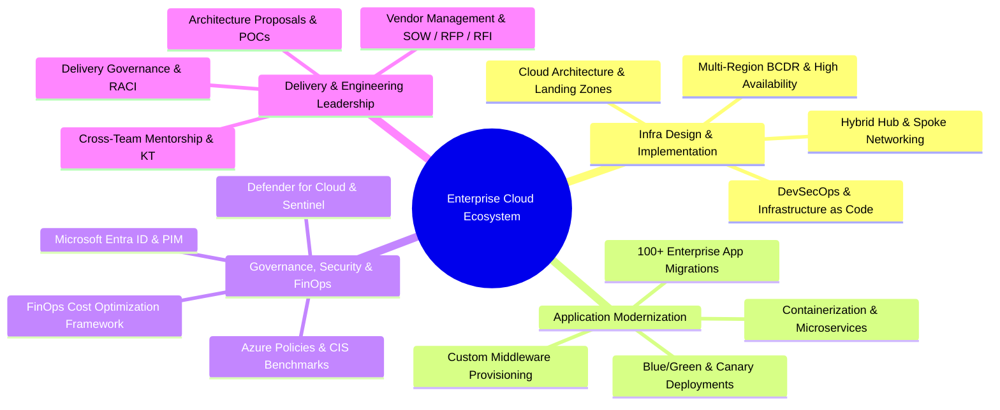
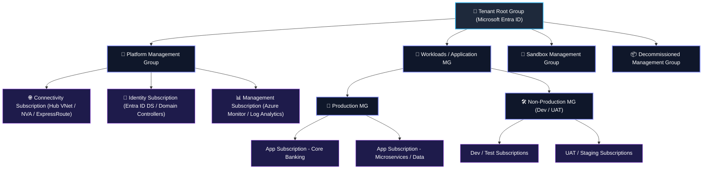
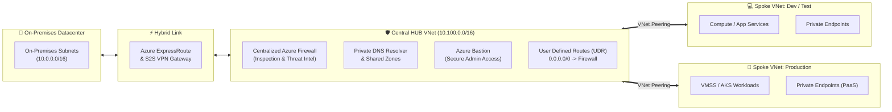
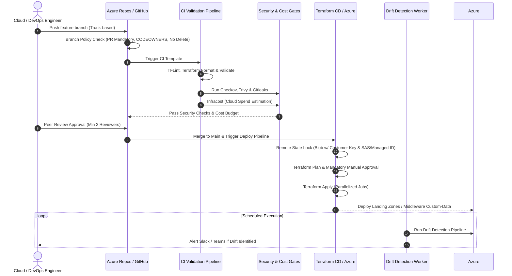
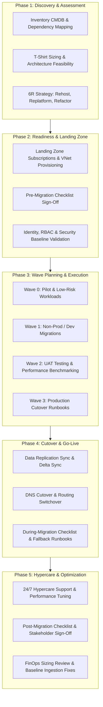

<!-- =========================================================================
     ADNAN AHMAD | SENIOR DEVSECOPS ENGINEER & CLOUD SOLUTIONS ARCHITECT
     GITHUB PROFILE README.MD
========================================================================= -->

<div align="center">

<!-- Animated Header Banner -->


<!-- Dynamic Animated Typing SVG -->
<a href="https://github.com/aahmad39">
  
</a>

<p align="center">
  <b>Architecting Resilient, Compliant, and Cost-Optimized Multi-Cloud Platforms at Scale</b>
</p>

<!-- Quick Contact & Social Badges -->
<p align="center">
  <a href="mailto:adnanhuntp@gmail.com">
    
  </a>
  <a href="https://www.linkedin.com/in/">
    
  </a>
  <a href="https://github.com/aahmad39">
    
  </a>
  <a href="#-technical-stack--tooling">
    
  </a>
</p>

</div>

---

### 👨‍💻 Executive Summary

Accomplished **Senior DevSecOps Engineer & Enterprise Cloud Solutions Architect** with deep expertise in **Microsoft Azure, Terraform Enterprise, Cloud Adoption Framework (CAF), and Zero-Trust Security**. 

Specialized in orchestrating end-to-end **Cloud Migrations of 100+ mission-critical applications** across Dev, UAT, and Production environments from on-premises datacenters to robust multi-subscription cloud ecosystems. Proven track record in designing Enterprise Azure Landing Zones (ALZ), automated CI/CD security guardrails (Shift-Left), comprehensive FinOps optimization, high-availability multi-region architectures, and managing cross-functional technical teams and vendor delivery.

```
┌──────────────────────────────────────────────────────────────────────────────────────────────────────┐
│  Architecture Attributes: Scalable • Robust • Secure • Reliable • Portable • Governed • High-Avail  │
│                           Cost-Optimized • Backed Up • Continuously Monitored • Compliant            │
└──────────────────────────────────────────────────────────────────────────────────────────────────────┘
```

---

### 🏛️ Core Architectural Pillars & Specializations



---

### 📐 1. Enterprise Azure Landing Zone & Governance Hierarchy

Designed according to Microsoft Cloud Adoption Framework (**CAF: Plan ➔ Ready ➔ Adopt ➔ Govern ➔ Secure ➔ Manage**), ensuring strict subscription boundaries, least privilege, and centralized traffic management.



#### 🛡️ Management Group & Tenant Hierarchy Best Practices:
* **Entra ID Tenant Boundaries**: Unified identity federation, PIM (Privileged Identity Management), Conditional Access, and break-glass emergency accounts.
* **Management Group Structure**: Hierarchical separation between `platform-mg` (Connectivity, Identity, Management) and workload application groups (`prod-mg`, `non-prod-mg`, `sandbox-mg`, `decommissioned-mg`).
* **Azure Policy & Initiatives**: Enterprise-wide enforcement of security baselines (CIS Azure Benchmark, NIST SP 800-53, ISO 27001), automated remediation tasks (`DeployIfNotExists`), and strictly documented policy exemption workflows with audit trails.
* **RBAC & Group Formation**: Persona-based RBAC groups mapped directly to Entra ID security groups; zero permanent Contributor/Owner assignments.
* **Subscription Lifecycle Management**: Infrastructure-as-Code automated subscription vending machine, onboarding/offboarding SOPs, and baseline tagging guardrails.

---

### 🌐 2. Hub-and-Spoke Enterprise Networking & Security



* **IP Address Management (IPAM) & CIDR Assessment**: Deep pre-migration assessment of on-premises subnets to ensure non-overlapping, scalable enterprise CIDR allocations across all subscriptions.
* **Centralized Traffic Inspection & Controlled Egress**: Hub VNet hosting Azure Firewall Premium with TLS inspection, IDPS, and custom UDR tables forcing all outbound/inter-spoke traffic through firewall filters.
* **Private PaaS Isolation**: Elimination of public IPs via Private Endpoints and Private Link for Storage, Key Vault, and SQL; centralized private DNS zone forwarders in the Hub VNet.
* **Multi-Layer Defense**:
  - **Identity Level**: Entra ID MFA, Conditional Access policies, Service Principals, and Workload Identities.
  - **Network Level**: Granular Network Security Groups (NSGs), Application Security Groups (ASGs), DDoS Network Protection.
  - **Governance Level**: Automated deny-rules for public IP assignment and unapproved Azure regions.
  - **Compute Level**: Hardened OS images, automated OS patch management, and Microsoft Defender for Servers / Containers.

---

### ⚙️ 3. DevSecOps & Terraform Landing Zone Automation



#### 🛠️ Terraform & CI/CD Engineering Standards:
* **Remote State Governance**: Azure Blob Storage backends with state locking, soft-delete, versioning, TLS 1.3, Customer-Managed Keys (CMK), and least-privilege Managed Identity access.
* **Reusable Modular Architecture**: Standardized, semantic-versioned modules for VNets, Subnets, NSGs, Private Endpoints, Compute, and Policies.
* **Shift-Left Security & Linting**:
  - Code hygiene: `tflint`, `terraform fmt -check`
  - Secret scanning: `gitleaks` & pre-commit hooks
  - Static security analysis: `checkov`, `tfsec`, `trivy`
  - FinOps in CI: `infracost` automated PR comments on cloud monthly cost impact
* **Branching Strategy & Azure Repos**:
  - Strict **Trunk-Based Branching** with short-lived feature branches
  - Enforced policies: Protected `main` branch (deletion disabled, direct pushes blocked), mandatory PRs, `CODEOWNERS` sign-off, maximum required reviewers
* **Modular Pipeline Templates**: YAML-based modular templates (`Validate & Test` ➔ `Build` ➔ `Security Scan` ➔ `Deployment / Apply` ➔ `Rollback`) with parallel execution.
* **Automated Middleware Bootstrapping**: Compute provisioning using custom data and cloud-init scripts for runtime configuration and middleware installation.

---

### 🚀 4. Enterprise Cloud Migration Framework (100+ Applications)

Structured 5-stage migration lifecycle engineered to migrate **100+ multi-tier workloads** across Dev, UAT, and Production with near-zero downtime.



#### 📋 Enterprise Migration Checklists:
* **Pre-Migration Checklist**: Source dependency mapping, bandwidth throttling validation, target Landing Zone readiness, firewall whitelisting, backup verification, and rollback criteria.
* **During-Migration Checklist**: Cutover step timing, database quiet period, final delta data sync, DNS TTL lowering, private endpoint validation, and smoke testing.
* **Post-Migration Checklist**: Performance metrics verification, Azure Monitor alerting configuration, backup policy activation, security scan verification, and operational handover.

---

### 💰 5. FinOps, High Availability & Disaster Recovery (BCDR)

| Strategic Pillar | Implementation Details & Best Practices |
| :--- | :--- |
| **Cloud Cost Optimization (FinOps)** | • **Idle Resource Reclamation**: Automated discovery and decommission of unattached managed disks, orphaned public IPs, and unused NICs.<br>• **Right-Sizing**: Continuous analysis of oversized compute instances based on 95th percentile CPU/RAM metrics.<br>• **Commitment Discounts**: Orchestration of Azure Reserved VM Instances (1-yr / 3-yr RIs) and Azure Savings Plans for stable compute.<br>• **Auto-Scheduling**: Scheduled automated start/stop runbooks for non-production Dev/UAT environments.<br>• **Log Optimization**: Log Analytics workspace data ingestion capping, retention tiering, and debug log elimination. |
| **High Availability (HA)** | • **Storage Redundancy**: Strategic selection of **LRS** (Dev), **ZRS** (Standard Prod), and **GRS** (Mission-Critical Data).<br>• **Compute Resilience**: Virtual Machine Scale Sets (**VMSS**) with multi-zone distribution across Azure Availability Zones with auto-healing. |
| **Disaster Recovery (BCDR)** | • **Strict SLAs**: Engineered architectures satisfying demanding **RTO** (Recovery Time Objective) and **RPO** (Recovery Point Objective) metrics.<br>• **Cross-Region Replication**: Primary region active workloads paired with automated failover pipelines to secondary paired Azure regions.<br>• **Backup Retention**: Azure Backup vault policies optimized for compliance retention without runaway storage overhead. |
| **Observability & Monitoring** | • **Azure Monitor Ecosystem**: Centralized Log Analytics Workspaces, Application Insights telemetry, and customized KQL queries.<br>• **Proactive Alerting**: Dynamic metric threshold alerts, Action Groups integrated with ITSM/Slack/Teams, and executive health dashboards. |

---

### 🤝 6. Delivery Leadership, Vendor Management & Pre-Sales

```
   ┌────────────────────────────────────────────────────────────────────────────────────────┐
   │                               DELIVERY & LEADERSHIP LIFECYCLE                          │
   ├────────────────────────────────────────────────────────────────────────────────────────┤
   │  [Pre-Sales & Proposals]     ➔ RFP / RFI Responses, Architectural POCs, Cost Models    │
   │  [Contracting & Governance]  ➔ SOW Definition, Deliverables, Acceptance Criteria, RACI  │
   │  [Sprint & Execution]        ➔ Technical Task Ownership, Risk Mitigation, Weekly Retro │
   │  [Vendor Oversight]          ➔ Evaluation Matrices, Least Privilege Access, Milestones │
   │  [Transition & Handover]     ➔ Comprehensive KT Sessions, SOP Documentation, Sign-Off   │
   │  [Team Enablement]           ➔ Senior Interviews, Mentorship, Team Upskilling Roadmaps │
   └────────────────────────────────────────────────────────────────────────────────────────┘
```

* **Vendor & Contract Management**:
  - Drafting and auditing detailed **Statements of Work (SOW)**, deliverables, dependencies, and contractual acceptance criteria.
  - Formulating **RFP (Request for Proposal)** and **RFI (Request for Information)** documents with quantitative **Technical Evaluation Matrices**.
  - Enforcing milestone-based deliverable sign-offs linked directly to payment milestones.
  - Designing vendor **Escalation Matrices** and granting strictly audited, time-bound least-privilege environment access.
* **Delivery Governance & RACI Framework**:
  - Defining clear accountability boundaries across internal engineering, operations, security, and third-party vendors.
  - Leading Agile cadences: Sprint planning, architecture review boards, weekly milestone reviews, and retro calls.
* **Transitions & Knowledge Transfer (KT)**:
  - Formulating structured SOPs (Standard Operating Procedures), architectural blueprints, and operational runbooks.
  - Conducting deep-dive technical KT sessions and hands-on workshops for operations handover.
* **Talent Upskilling & Engineering Initiatives**:
  - Conducting senior-level technical interviews for DevOps, SRE, and Cloud Architect roles.
  - Running internal architectural guilds and upskilling roadmaps on Cloud, Terraform, and DevSecOps best practices.

---

### 🧰 Technical Stack & Tooling

<div align="center">

| Domain | Technologies & Frameworks |
| :--- | :--- |
| **Cloud Platforms** |    |
| **IaC & Automation** |    |
| **CI/CD & DevSecOps** |    |
| **Security & Policy** |      |
| **Containers & K8s** | -326CE5?style=flat-square&logo=kubernetes&logoColor=white)   |
| **Observability & FinOps** |  -F25022?style=flat-square)  |
| **Scripting & OS** |    -FCC624?style=flat-square&logo=linux&logoColor=black) |

</div>

---

### 📊 GitHub Activity & Metrics

<div align="center">

<table border="0">
  <tr>
    <td align="center" width="50%">
      <a href="https://github.com/aahmad39">
        
      </a>
    </td>
    <td align="center" width="50%">
      <a href="https://github.com/aahmad39">
        
      </a>
    </td>
  </tr>
  <tr>
    <td align="center" colspan="2">
      <a href="https://github.com/aahmad39">
        
      </a>
    </td>
  </tr>
</table>

</div>

---

<div align="center">

### 📬 Let's Connect & Collaborate

Whether you're looking to architect a secure enterprise cloud foundation, execute large-scale application migrations, or establish automated DevSecOps pipelines:

[](mailto:adnanhuntp@gmail.com)
[](https://www.linkedin.com/in/)
[](https://github.com/aahmad39)

<br/>


</div>
