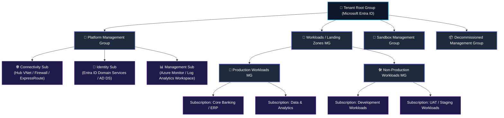
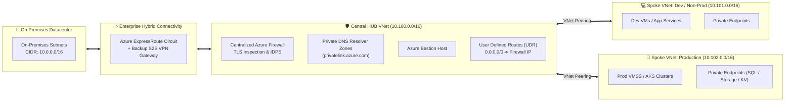
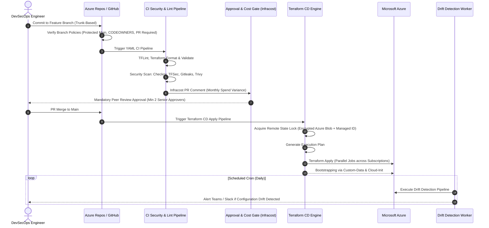

<!-- =========================================================================
     ADNAN AHMAD | SENIOR DEVSECOPS ENGINEER & CLOUD SOLUTIONS ARCHITECT
     ENTERPRISE GITHUB PROFILE README.MD
========================================================================= -->

<div align="center">

<!-- Animated Header Banner -->


<!-- Dynamic Animated Typing SVG -->
<a href="https://github.com/aahmad39">
  
</a>

<p align="center">
  <b>Enterprise Cloud Architecture • Infrastructure as Code (Terraform) • DevSecOps CI/CD • FinOps • Large-Scale Migrations</b>
</p>

<!-- Quick Navigation Bar -->
<p align="center">
  <a href="#-enterprise-architectural-pillars"></a>
  <a href="#-1-tenant--management-group-hierarchy-caf"></a>
  <a href="#-2-hub-and-spoke-networking--hybrid-connectivity"></a>
  <a href="#-3-multi-layer-defense-in-depth-security"></a>
  <a href="#-4-terraform-enterprise-landing-zone-automation--devsecops"></a>
  <a href="#-5-100-enterprise-applications-migration-framework"></a>
  <a href="#-6-finops-cloud-economics--bcdr"></a>
  <a href="#-7-vendor-management-delivery-governance--leadership"></a>
</p>

<!-- Contact Badges -->
<p align="center">
  <a href="mailto:adnanhuntp@gmail.com">
    
  </a>
  <a href="https://www.linkedin.com/in/">
    
  </a>
  <a href="https://github.com/aahmad39">
    
  </a>
</p>

</div>

---

### 💼 Executive Overview

Accomplished **Senior DevSecOps Engineer & Enterprise Cloud Solutions Architect** specializing in architecting, automating, and securing mission-critical enterprise cloud ecosystems on **Microsoft Azure**. 

Proven authority in executing end-to-end **large-scale migrations of 100+ workloads** from legacy on-premises datacenters to multi-subscription Azure environments across Dev, UAT, and Production. Recognized for implementing **Enterprise Azure Landing Zones (ALZ)** based on Microsoft Cloud Adoption Framework (CAF), automated DevSecOps pipelines with shift-left security gates, FinOps cost optimization governance, multi-region disaster recovery (BCDR), and full-lifecycle technical delivery & vendor management.

```
┌──────────────────────────────────────────────────────────────────────────────────────────────────────────────────┐
│  CORE ARCHITECTURAL PRINCIPLES:                                                                                  │
│  ✔ Scalable   ✔ Robust   ✔ Secure   ✔ Reliable   ✔ Portable   ✔ Governed   ✔ High-Avail   ✔ Cost-Optimized       │
│  ✔ Automated  ✔ Backed Up   ✔ End-to-End Monitored   ✔ Audit & Regulatory Compliant (CIS / ISO / SOC2)          │
└──────────────────────────────────────────────────────────────────────────────────────────────────────────────────┘
```

---

### 🏛️ Enterprise Architectural Pillars

<table width="100%">
  <tr>
    <td width="50%" valign="top">
      <div align="center">
        <h3>🏗️ Infra Design & Implementation</h3>
      </div>
      <ul>
        <li><b>Cloud Architecture & Landing Zones:</b> CAF-aligned modular multi-subscription foundation.</li>
        <li><b>DevSecOps & Infrastructure as Code:</b> Terraform Enterprise, reusable modules, automated drift detection.</li>
        <li><b>Hybrid & Hub-Spoke Networking:</b> ExpressRoute, VPN Gateways, Central Firewall, Private Endpoints.</li>
        <li><b>Enterprise Resiliency:</b> Multi-region Disaster Recovery, VMSS, and strict RTO/RPO SLAs.</li>
      </ul>
    </td>
    <td width="50%" valign="top">
      <div align="center">
        <h3>💻 Application System Design & Modernization</h3>
      </div>
      <ul>
        <li><b>100+ Application Migration:</b> 6-R migration strategy across Dev, UAT, and Production.</li>
        <li><b>Application Containerization:</b> Azure Kubernetes Service (AKS), Docker, Helm chart packaging.</li>
        <li><b>Automated Middleware Provisioning:</b> Cloud-init & custom data scripts for OS/middleware configuration.</li>
        <li><b>Zero-Downtime Deployment:</b> Blue/Green, Canary releases, and automated rollback triggers.</li>
      </ul>
    </td>
  </tr>
  <tr>
    <td width="50%" valign="top">
      <div align="center">
        <h3>🛡️ Governance, Security & FinOps</h3>
      </div>
      <ul>
        <li><b>Identity & Access Management:</b> Microsoft Entra ID, PIM, Conditional Access, custom RBAC.</li>
        <li><b>Policy as Code:</b> Azure Policy Initiatives, automated remediation, audited exemption workflows.</li>
        <li><b>Continuous Threat Defense:</b> Microsoft Defender for Cloud, Sentinel SIEM, vulnerability scanning.</li>
        <li><b>FinOps Economics:</b> Idle resource reclamation, right-sizing, Reserved Instances & Savings Plans.</li>
      </ul>
    </td>
    <td width="50%" valign="top">
      <div align="center">
        <h3>🤝 Delivery Leadership & Vendor Management</h3>
      </div>
      <ul>
        <li><b>Contracting & Proposals:</b> SOW, RFP, RFI, Architecture POCs, and Technical Evaluation Matrices.</li>
        <li><b>Delivery Governance:</b> RACI matrix, sprint ownership, acceptance criteria, milestone sign-offs.</li>
        <li><b>Transitions & Handover:</b> SOPs, runbooks, structured Knowledge Transfer (KT) frameworks.</li>
        <li><b>Team Enablement:</b> Upskilling strategy, hiring & senior technical interviews, architecture guilds.</li>
      </ul>
    </td>
  </tr>
</table>

---

### 🏢 1. Tenant & Management Group Hierarchy (CAF)

> **Cloud Adoption Framework (CAF) Strategy:** Formulating enterprise cloud strategy through continuous lifecycle stages:  
> **Plan ➔ Ready ➔ Adopt ➔ Govern ➔ Secure ➔ Manage**



<details open>
<summary><b>🔍 Deep-Dive: Hierarchy, Policies & Tenant Best Practices (Click to collapse/expand)</b></summary>
<br>

* **Microsoft Entra ID (Azure AD) Tenant Architecture:**
  - Strict tenant boundaries separating corporate identities, service principals, and workload identities.
  - Break-Glass Accounts: Cloud-only emergency accounts excluded from Conditional Access with 24/7 alert monitoring.
  - Privileged Identity Management (PIM): Just-In-Time (JIT) access with mandatory business justifications and multi-approver workflow.
* **Management Group Hierarchy & Subscription Boundaries:**
  - Dedicated `platform-mg` isolating foundational shared services from application workloads.
  - Strict segregation between `production-mg` and `non-production-mg` to enforce environment-specific compliance and network isolation.
  - Isolated `sandbox-mg` for R&D with budget caps, and `decommissioned-mg` with zero privileges for offboarding subscriptions.
* **Azure Policy & Initiatives Assignments:**
  - Root-level guardrails: Mandating resource tags (`Environment`, `CostCenter`, `Owner`), restricting allowable Azure regions, and denying public IP assignments to VMs.
  - CIS Microsoft Azure Foundations Benchmark initiative applied across all workload subscriptions.
  - Automated remediation with `DeployIfNotExists` policies (e.g., auto-enrolling VMs into Log Analytics and Defender for Cloud).
* **Policy Exemptions Governance:**
  - Formal workflow requiring written business justification, expiration dates, security review, and audit trail logging before exemption approval.
* **Automated Subscription Lifecycle Management:**
  - IaC-driven Subscription Vending Machine with pre-configured network peering, RBAC roles, and policy bindings.
  - Clear SOPs for seamless subscription onboarding, credential rotation, and clean offboarding.

</details>

---

### 🌐 2. Hub-and-Spoke Networking & Hybrid Connectivity



<details open>
<summary><b>🔍 Deep-Dive: Networking Standards, IPAM & Traffic Routing</b></summary>
<br>

* **IP Address Management (IPAM) & On-Premises CIDR Assessment:**
  - Comprehensive pre-migration subnet audit to eliminate overlapping IP space with on-premises datacenters.
  - Scalable enterprise CIDR allocation plan accommodating future multi-region expansion and container IP exhaustion (AKS CNI).
* **Hub VNet Design Best Practices:**
  - Centralized Azure Firewall Premium acting as the single default egress gateway with deep packet inspection and threat intelligence.
  - Azure Bastion deployment for agentless, secure RDP/SSH management over SSL without exposing public IPs.
* **Controlled Traffic Steering via User Defined Routes (UDR):**
  - Custom route tables attached to all Spoke subnets routing `0.0.0.0/0` (internet) and inter-spoke traffic directly through the central Azure Firewall.
  - Gateway transit enabled on Hub-to-Spoke peering for seamless hybrid connectivity.
* **Private PaaS Exposure (Zero Public IPs):**
  - Integration of Azure Private Endpoints for Key Vault, Azure SQL, Blob Storage, and App Services.
  - Centralized Azure Private DNS Zones hosted in the Hub VNet linked to all Spoke VNets with conditional forwarding.

</details>

---

### 🔒 3. Multi-Layer Defense-in-Depth Security

<table width="100%">
  <tr>
    <td width="25%" align="center">
      <h4>🔑 1. Identity Level</h4>
    </td>
    <td width="25%" align="center">
      <h4>🌐 2. Networking Level</h4>
    </td>
    <td width="25%" align="center">
      <h4>📜 3. Governance Level</h4>
    </td>
    <td width="25%" align="center">
      <h4>💻 4. Compute Level</h4>
    </td>
  </tr>
  <tr>
    <td valign="top">
      <ul>
        <li>Microsoft Entra ID</li>
        <li>Privileged Identity Management (PIM)</li>
        <li>Conditional Access Policies</li>
        <li>Phishing-Resistant MFA</li>
        <li>Service Principals & Managed Identities</li>
        <li>Break-Glass Accounts</li>
      </ul>
    </td>
    <td valign="top">
      <ul>
        <li>Hub-and-Spoke Isolation</li>
        <li>Centralized Azure Firewall Premium</li>
        <li>NSGs & Application Security Groups (ASGs)</li>
        <li>Private Endpoints & Private Link</li>
        <li>DDoS Network Protection</li>
        <li>Controlled Egress via UDRs</li>
      </ul>
    </td>
    <td valign="top">
      <ul>
        <li>Azure Policy Guardrails</li>
        <li>CIS Azure Benchmark v2.0</li>
        <li>Regulatory Compliance (ISO27001, SOC2)</li>
        <li>Policy Exemption Auditing</li>
        <li>Automated Remediation (DeployIfNotExists)</li>
        <li>Resource Lock Enforcement</li>
      </ul>
    </td>
    <td valign="top">
      <ul>
        <li>CIS Hardened Golden Images</li>
        <li>Microsoft Defender for Cloud</li>
        <li>Defender for Servers & Containers</li>
        <li>Automated OS Patch Orchestration</li>
        <li>Vulnerability Assessment (Qualys/Trivy)</li>
        <li>Disk Encryption with Customer Keys</li>
      </ul>
    </td>
  </tr>
</table>

---

### ⚙️ 4. Terraform Enterprise Landing Zone Automation & DevSecOps



<details open>
<summary><b>🔍 Deep-Dive: IaC Best Practices & DevSecOps Pipeline Governance</b></summary>
<br>

* **Terraform Remote State Governance:**
  - Remote state stored in private Azure Storage Accounts with Blob versioning, soft-delete, and state locking.
  - State files encrypted at rest using Customer-Managed Keys (CMK) and TLS 1.3 in transit.
  - Strict least-privilege access to state files via Azure RBAC and Managed Identities (no shared connection strings).
* **Reusable Modular Architecture:**
  - DRY (Don't Repeat Yourself) modular structure with strict semantic versioning.
  - Separate modular codebases for `alz-management-groups`, `alz-networking-hub-spoke`, `alz-security-policies`, and `alz-workloads`.
* **Shift-Left Quality & Security Gates:**
  - **Static Analysis & Linting:** `tflint` with Azure rule-set, `terraform fmt -check`.
  - **Secret Scanning:** `gitleaks` pre-commit hooks and pipeline blockers.
  - **Policy-as-Code:** `checkov` and `tfsec` scanning for insecure configurations before merge.
  - **FinOps in CI:** Automated `infracost` analysis posting monthly cost impact directly as a PR comment.
* **Scheduled Drift Detection Pipelines:**
  - Automated headless pipeline running `terraform plan -detailed-exitcode` on a daily schedule to identify manual changes and alert teams for remediation.
* **Azure Repos & Pipeline Branch Policies:**
  - **Trunk-Based Development:** Short-lived feature branches merged frequently to `main`.
  - **Main Branch Protection:** Direct push and deletion disabled; PR mandatory; minimum 2 reviewers required; `CODEOWNERS` file approval required.
  - **Modular Pipeline Templates:** Reusable YAML templates for `Validate & Test`, `Build`, `Security Scan`, `Deployment / Apply`, and `Automated Rollback`.
  - **Middleware Provisioning:** Dynamic bootstrap scripts (`custom_data` / `cloud-init`) configured in Terraform for automated agent and middleware installation.

</details>

---

### 🚀 5. 100+ Enterprise Applications Migration Framework

> **Migration Context:** Large-scale enterprise migration of **100+ multi-tier applications** from legacy on-premises datacenters and disparate subscriptions into governed Azure Landing Zones across **Dev, UAT, and Production**.

```mermaid
flowchart TD
    subgraph P1["Phase 1: Discovery & Assessment"]
        A1["Automated CMDB & Dependency Mapping (Azure Migrate)"]
        A2["Application T-Shirt Sizing & Architecture Feasibility"]
        A3["6R Strategy Definition: Rehost • Replatform • Refactor • Retire • Retain • Repurchase"]
    end

    subgraph P2["Phase 2: Readiness & Landing Zone Foundation"]
        B1["Landing Zone Subscription Provisioning via IaC"]
        B2["Target VNet Peering, UDR & Private Endpoints Ready"]
        B3["Pre-Migration Sign-Off & Rollback Runbook Approval"]
    end

    subgraph P3["Phase 3: Wave Planning & Non-Prod Migrations"]
        C1["Wave 0: Pilot & Low-Risk Workloads"]
        C2["Wave 1: Dev / Test Environment Migrations"]
        C3["Wave 2: UAT Migrations & Performance Benchmarking"]
    end

    subgraph P4["Phase 4: Production Cutover"]
        D1["Continuous Block-Level Data Replication & Delta Sync"]
        D2["Application Maintenance Window & Database Quiet Period"]
        D3["DNS TTL Reduction & Global Traffic Cutover"]
    end

    subgraph P5["Phase 5: Post-Cutover & Hypercare"]
        E1["24/7 Hypercare Command Center & Incident Response"]
        E2["Post-Migration Checklist Sign-Off & RACI Handover"]
        E3["FinOps Sizing Audit & Log Ingestion Baseline Tuning"]
    end

    P1 ➔ P2 ➔ P3 ➔ P4 ➔ P5
```

#### 📋 Enterprise Migration Checklists Matrix:

| Migration Stage | Mandatory Verification Tasks & Gate Criteria |
| :--- | :--- |
| **1. Pre-Migration Checklist** | • Inventory discovery complete and CMDB up to date.<br>• Non-overlapping CIDR verified; ExpressRoute bandwidth tested.<br>• Target Landing Zone subscriptions, policies, and Private Endpoints provisioned.<br>• Source database quiet period scheduled and backup verified.<br>• Step-by-step rollback runbook drafted, tested, and approved. |
| **2. During-Migration Checklist** | • Delta data synchronization completed and validated.<br>• Compute services initiated and configured with custom-data bootstrap scripts.<br>• Firewall rules and NSG flows validated; Private DNS resolution confirmed.<br>• DNS TTL lowered to 300s; DNS cutover executed.<br>• Health check smoke tests executed against all tiers (Web, App, DB). |
| **3. Post-Migration Checklist** | • Application functional validation and performance benchmark sign-off.<br>• Azure Monitor, Log Analytics, and Alert Action Groups active.<br>• Azure Backup vault policies assigned with verified recovery points.<br>• Security vulnerability scan passed with zero high/critical findings.<br>• Stakeholder cutover sign-off and transition to Hypercare support. |
| **4. Cutover & Hypercare** | • 24/7 war room support for the initial 14-day hypercare period.<br>• Rapid issue triage and root cause analysis (RCA) documentation.<br>• Formal operational documentation handover to operations team via KT sessions. |

---

### 💰 6. FinOps, Cloud Economics & Resiliency (BCDR)

<table width="100%">
  <tr>
    <td width="50%" valign="top">
      <div align="center">
        <h3>💡 FinOps & Cost Optimization</h3>
      </div>
      <ul>
        <li><b>Idle Resource Reclamation:</b> Automated discovery and deletion of unattached managed disks, orphaned public IPs, and unused NICs.</li>
        <li><b>Compute Right-Sizing:</b> Continuous performance profiling (CPU/RAM p95 metrics) to downsize oversized VMs.</li>
        <li><b>Commitment Discounts:</b> Orchestrating 1-year and 3-year Azure Reserved VM Instances (RIs) and Azure Savings Plans.</li>
        <li><b>Automated VM Scheduling:</b> Runbooks automatically stopping non-production Dev/UAT workloads outside business hours.</li>
        <li><b>Log Ingestion Optimization:</b> Log Analytics workspace daily data ingestion capping, table retention tiering, and debug log filtering.</li>
        <li><b>Backup Retention Lifecycle:</b> Optimizing Azure Backup retention rules to eliminate redundant long-term storage costs.</li>
      </ul>
    </td>
    <td width="50%" valign="top">
      <div align="center">
        <h3>🛡️ High Availability, BCDR & Monitoring</h3>
      </div>
      <ul>
        <li><b>Storage Redundancy:</b> Implementation of <b>LRS</b> (Dev), <b>ZRS</b> (Zone-redundant for standard Prod), and <b>GRS</b> (Cross-region replication for critical databases).</li>
        <li><b>Compute High Availability:</b> Virtual Machine Scale Sets (<b>VMSS</b>) spanning across Azure Availability Zones with automated auto-scaling.</li>
        <li><b>Strict RTO & RPO Targets:</b> Architectures engineered to meet aggressive Recovery Time Objectives (RTO) and Recovery Point Objectives (RPO).</li>
        <li><b>Multi-Region Disaster Recovery:</b> Primary operational region paired with automated failover pipelines to secondary paired Azure region.</li>
        <li><b>Full-Stack Observability:</b> Centralized Azure Monitor, Log Analytics Workspaces, Application Insights, dynamic metric alerts, and automated Action Groups.</li>
      </ul>
    </td>
  </tr>
</table>

---

### 🤝 7. Vendor Management, Delivery Governance & Leadership

```
┌──────────────────────────────────────────────────────────────────────────────────────────────────────────────────┐
│                                     END-TO-END DELIVERY LEADERSHIP LIFECYCLE                                     │
├──────────────────────────────────────────────────────────────────────────────────────────────────────────────────┤
│  [Pre-Sales & Proposals]     ➔ SOW Definition, RFP / RFI Documentation, Commercials, Architecture POCs           │
│  [Technical Ownership]       ➔ Task Assignment, Dependency Mapping, Risk Register, Acceptance Criteria          │
│  [Vendor Governance]         ➔ Technical Evaluation Matrix, Least Privilege Access, Deliverable Sign-Offs        │
│  [Agile Delivery Execution]  ➔ Sprint Planning, Weekly Review Cadence, Sprint Retrospectives, Milestones         │
│  [Transition & Handover]     ➔ SOP Creation, Architecture Blueprints, RACI Matrix, Knowledge Transfer (KT)      │
│  [Team Enablement]           ➔ Senior Technical Interviews, Mentorship Programs, Architecture Upskilling         │
└──────────────────────────────────────────────────────────────────────────────────────────────────────────────────┘
```

<details open>
<summary><b>🔍 Deep-Dive: SOW, RFP/RFI, RACI Matrix & Team Enablement</b></summary>
<br>

* **Vendor Management & Contractual Governance:**
  - **Statements of Work (SOW):** Drafting and reviewing detailed SOWs with concrete scopes, deliverables, sprint schedules, dependency mappings, and enforceable acceptance criteria.
  - **RFP & RFI Formulations:** Creating technical Request for Proposal (RFP) and Request for Information (RFI) documents; formulating quantitative **Technical Evaluation Matrices** to objectively assess vendor architectural capabilities.
  - **Milestone-Based Governance:** Aligning commercial payment milestones with rigorous technical sign-offs and deliverable acceptance gates.
  - **Least-Privilege Vendor Access:** Designing time-bound, PIM-controlled access environments for vendor personnel with full session auditing.
  - **Escalation Matrix Design:** Establishing clear technical and executive escalation pathways to resolve cross-vendor roadblocks rapidly.
* **Delivery Governance & RACI Framework:**
  - Establishing explicit **RACI Matrices** (Responsible, Accountable, Consulted, Informed) across enterprise architects, platform engineers, security leads, and vendor teams.
  - Leading Agile ceremonies: Sprint planning, architecture review boards, weekly project reviews, and retrospective calls.
* **Transitions & Knowledge Transfer (KT):**
  - Standard Operating Procedures (SOPs), disaster recovery runbooks, and architectural decision records (ADRs).
  - Structured, recorded KT sessions and hands-on workshops ensuring smooth operational handover to internal teams.
* **Team Enablement & Technical Hiring:**
  - Conducting senior-level technical interviews for DevOps, Cloud Architect, and SRE candidates.
  - Formulating upskilling roadmaps and conducting training workshops on Azure Landing Zones, Terraform, and DevSecOps.

</details>

---

### 🧰 Comprehensive Technical Toolchain

<div align="center">

| Category | Primary Technologies & Tooling |
| :--- | :--- |
| **Cloud Platforms** |    |
| **Infrastructure as Code** |    |
| **CI/CD & Repositories** |    |
| **Security & Policy-as-Code** |      |
| **Containers & Orchestration** | -326CE5?style=flat-square&logo=kubernetes&logoColor=white)   |
| **FinOps & Observability** |  -F25022?style=flat-square)  |
| **Scripting & OS** |    -FCC624?style=flat-square&logo=linux&logoColor=black) |

</div>

---

### 📊 Live GitHub Activity & Statistics

<div align="center">

<table border="0" width="100%">
  <tr>
    <td align="center" width="50%">
      <a href="https://github.com/aahmad39">
        
      </a>
    </td>
    <td align="center" width="50%">
      <a href="https://github.com/aahmad39">
        
      </a>
    </td>
  </tr>
  <tr>
    <td align="center" colspan="2">
      <a href="https://github.com/aahmad39">
        
      </a>
    </td>
  </tr>
</table>

</div>

---

<div align="center">

### 📬 Connect & Collaborate

Whether you're architecting an enterprise Azure Landing Zone, planning a 100+ workload migration, or automating DevSecOps pipelines:

[](mailto:adnanhuntp@gmail.com)
[](https://www.linkedin.com/in/)
[](https://github.com/aahmad39)

<br/>


</div>
